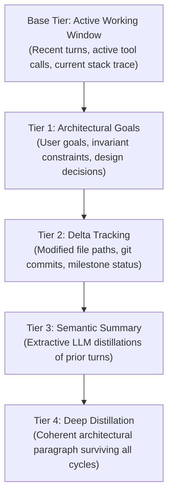

## Why Dynamic Compaction Matters

Context limits vary widely across modern LLMs — from 32k/64k in lightweight local models to 200k in standard cloud models, and up to 1M–2M tokens in massive flagship models.

Static compaction thresholds fail across environments:
- A rigid 100k threshold overflows an 8k or 32k local Ollama model.
- A rigid 50k threshold forces premature summarization on Claude 3.7 Sonnet or Gemini 2.5 Pro, destroying valuable reasoning steps.

---

## Model-Tier Compaction Engine

SAGO introduces dynamic model-tier thresholding (`sago/memory/compaction.py`):

| Model Tier | Target Models | Trigger Threshold | Pruned Target | Message Guard |
|---|---|---|---|---|
| **Local Tier** | Ollama, LM Studio, vLLM, `llama3`, `mistral-7b` | **75,000 tokens** | **35,000 tokens** | 20 messages |
| **Standard Cloud Tier** | Claude 3.5/3.7 Sonnet, GPT-4o, DeepSeek-V3, Groq | **175,000 tokens** | **80,000 tokens** | 45 messages |
| **Massive Context Tier** | Gemini 1.5/2.0/2.5 Pro & Flash, Claude 1M, Qwen 1M | **750,000 tokens** | **250,000 tokens** | 120 messages |

### Environment Variable Overrides

Customize triggers per deployment via environment variables:

```bash
# Override local tier trigger threshold
export SAGO_COMPACTION_THRESHOLD_LOCAL=60000

# Override standard cloud tier trigger threshold
export SAGO_COMPACTION_THRESHOLD_STANDARD=160000

# Override massive tier trigger threshold
export SAGO_COMPACTION_THRESHOLD_MASSIVE=800000

# Global universal override across all models
export SAGO_COMPACTION_THRESHOLD=150000
```

---

## Hierarchical Memory Pyramid

When compaction triggers, SAGO preserves critical context using a multi-tiered **Hierarchical Memory Pyramid** (`HierarchicalMemoryPyramid` in `sago/memory/compaction.py`):



### Pyramid Layers Explained

1. **Base Tier (Active Working Window):** Retains recent conversational turns with full fidelity for immediate problem solving.
2. **Tier 1 (Architectural Invariants):** Automatically captures user goals, decisions, and constraints (`goal:`, `decided to:`, `must support:`).
3. **Tier 2 (Delta Tracking):** Tracks all files modified during the session, test execution outcomes, and completed milestones.
4. **Tier 3 (Semantic Summary):** LLM-distilled summaries of compacted conversation history.
5. **Tier 4 (Deep Distillation):** A concentrated synthesis that survives aggressive long-horizon sessions lasting hundreds of turns.

---

## Context Poisoning Guard

When an agent operates on large codebases, modifying 50+ or 100+ files can inject thousands of lines of file path strings into the prompt. This causes **Context Poisoning** — the model's attention is consumed by repetitive directory trees, leading to hallucinations.

SAGO automatically activates the **Context Poisoning Guard**:
- Large file lists are clustered by parent directory.
- Diffs touching 100+ files are summarized with delta caps:
  ```text
  Modified Files (142 total):
  - src/auth/jwt.py (modified)
  - src/auth/session.py (modified)
  - src/api/v1/router.py (modified)
  ... (+139 more files across src/db/, tests/)
  ```

---

## Prompt Enhancer Summary (2–7 Lines)

Before each main LLM call, `PromptEnhancer.summarize_working_context()` extracts a crisp 2-to-7 line distillation of prior turns.

In the Textual TUI, this is displayed non-intrusively in a collapsible turn card:
```text
✨ Enhanced Prompt
  ● Goal: Implement Redis connection pooling with exponential backoff retry.
  ● Constraints: Zero breaking changes to `acquire_client()` API signature.
  ● Current Phase: Verifying tests in tests/unit/test_pool.py.
```
