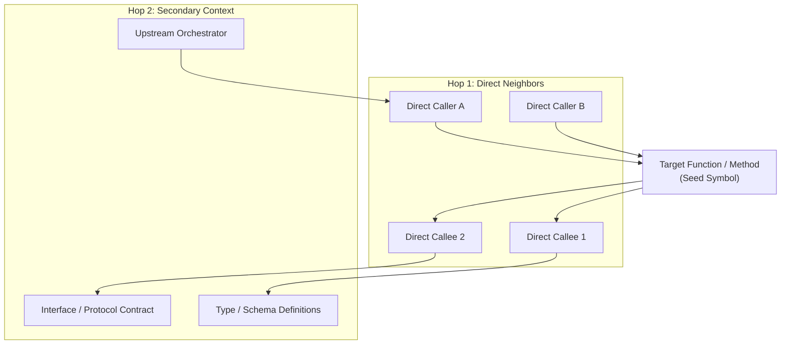
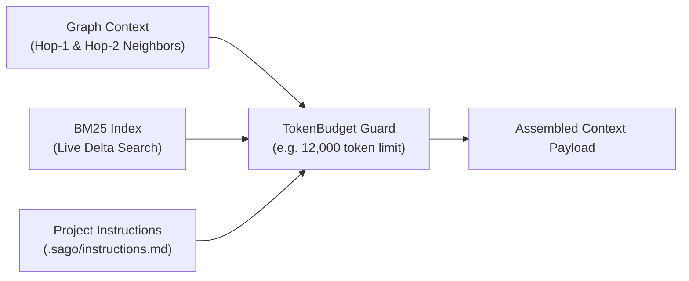

## The Pitfall of Traditional Semantic Search (RAG)

Standard RAG (Retrieval-Augmented Generation) uses vector similarity or BM25 keywords to pull snippets into prompt context. While helpful for general questions, vector search frequently fails software engineering tasks because:
- High cosine similarity does not imply architectural dependency.
- Crucial type signatures, interface implementations, and upstream callers are omitted because their text doesn't match the query keywords.
- Unrelated utility functions with similar wording pollute the context.

---

## 2-Hop Bidirectional Call Graph

SAGO resolves this with **Graph-Guided Context Assembly** (`sago/memory/call_graph.py` and `sago/engine/context_assembler.py`).

Instead of guessing relevant code, SAGO extracts actual symbol relationships using AST call-site analysis:

---

## Neighborhood Traversal Algorithm

When inspecting a symbol or debugging an issue, SAGO's `CallGraph.get_n_hop_neighborhood(seed_symbols, max_hops=2)` performs breadth-first search (BFS):

1. **Hop 1 (Direct Inward & Outward Edges):**
   - **Callers (`get_callers`):** Functions or methods that invoke the target symbol. Crucial for understanding callers' expectations, invariants, and error contracts.
   - **Callees (`get_callees`):** Downstream functions invoked by the target symbol. Crucial for understanding dependencies and return values.

2. **Hop 2 (Secondary Structural Edges):**
   - Upstream API handlers or CLI command routers.
   - Pydantic models, TypeScript types, or database schemas passed across the boundary.

---

## The Context Assembler Pipeline

`ContextAssembler` (`sago/engine/context_assembler.py`) unifies structural graphs, project instructions, and working memory within a strict token budget:

### Context Assembly Features

- **Strict Token Budgeting (`_TokenBudget`):** Guarantees that injected graph context never exhausts model context limits or starves message history.
- **Delta Capping for Large Changesets:** When over 100 files are modified or scanned, `ContextAssembler` caps file lists (`Modified Files (N total): file1, file2 ... (+N more)`) to prevent context poisoning.
- **Short-Circuit for Summary Queries:** When the user asks summary questions (`what did you do?`, `/summary`), the heavy BFS graph traversal is cleanly bypassed, immediately generating an extractive LLM summary without token waste.
