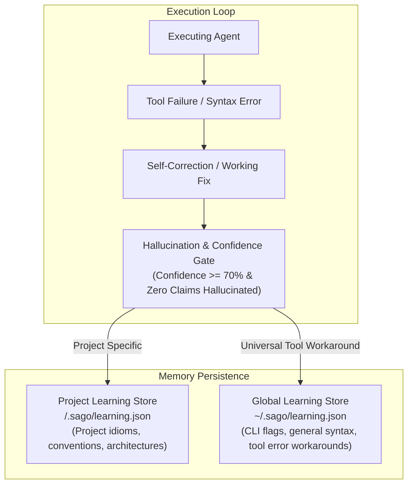

## Why Global Memory Fails

Many AI coding tools use a single global memory file for all projects. This causes severe cross-repository contamination:
- One project uses Django with snake_case ORM conventions; another uses TypeScript Prisma with camelCase.
- Custom internal scripts or testing frameworks in Project A get hallucinated into Project B.

---

## Dual-Scope Learning Architecture

SAGO introduces a two-tier learning store (`sago/learning.py`):



---

## Scope Hierarchy & Resolution

When SAGO plans an approach or encounters an error, `get_learning_store(project_root)` queries the stores in priority order:

1. **Project-Scoped Learnings (`<project_root>/.sago/learning.json`):**
   - Repository-specific conventions (e.g. *"In this repo, test files are located under `tests/integration/` not `test/`"*).
   - Custom build commands (e.g. *"Use `make dev-test` instead of `pytest` directly"*).
   - Specific architectural patterns and preferred module imports.

2. **Global Learnings (`~/.sago/learning.json`):**
   - Cross-cutting tool workarounds (e.g. *"Calling `read_file` on a directory fails with IsADirectoryError; use `glob_files` instead"*).
   - Universal CLI error corrections and flag patterns.

---

## The Hallucination Verification Gate

To prevent poisoning the learning store with invalid "fixes" or fabricated patterns, every recorded pattern must pass through the **Confidence & Verification Gate**:

- **Confidence Threshold:** The pattern must have an assessed confidence score $\ge 70\%$.
- **Hallucination Detection:** The 9-stage `HallucinationVerifier` inspects the candidate pattern. If any fabricated imports, invalid URLs, or hallucinated claims are detected, the entry is immediately discarded.

---

## Learning Store Data Structure

The JSON structure stored in `.sago/learning.json`:

```json
{
  "successful_approaches": {
    "CODE_REFACTOR": [
      {
        "approach": "Extract AST skeleton before modifying public signatures",
        "tools_used": ["tree_sitter_skeleton", "grep_content", "edit_file"],
        "timestamp": "2026-10-24T18:30:00Z"
      }
    ]
  },
  "known_fixes": {
    "read_file:IsADirectoryError": "Use glob_files or file_operations(list) instead of read_file on directory paths",
    "pytest:ModuleNotFoundError": "Run pytest with python -m pytest to include cwd in PYTHONPATH"
  },
  "tool_stats": {
    "edit_file": { "success": 42, "failure": 1 },
    "execute_shell": { "success": 28, "failure": 2 }
  },
  "language_patterns": {
    "python": [
      {
        "pattern": "type_annotations",
        "details": "Use PEP 604 union syntax (int | None) rather than Optional[int]"
      }
    ]
  }
}
```

---

## Inspecting & Clearing Learnings

In the SAGO TUI or terminal:

```bash
# View active project learnings in TUI
/status

# Learnings file can be checked or committed to version control:
cat .sago/learning.json

# Reset project learnings if conventions change:
rm -f .sago/learning.json
```
