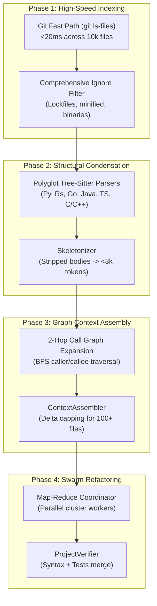

## The 4-Phase Scale Engine

SAGO scales reliably to massive monorepos and polyglot codebases using a 4-phase architecture:

---

## Architectural Principles

1. **Deterministic Code Intelligence:** SAGO never relies solely on vector similarity (RAG) for symbol navigation. AST parsing, import graphs, and call graphs provide mathematically exact relationship mapping.
2. **Dynamic Context Guards:** Context compaction thresholds adapt automatically to model context lengths (Local 50k–100k, Standard 150k–200k, Massive 750k–1M).
3. **Pure Model Context:** Telemetry, compaction notices, and status cards are displayed to the user via UI callbacks, never injected into the LLM conversation payload.
4. **Isolated Project Learning:** Learnings are stored at the project root (`.sago/learning.json`) to prevent cross-repo contamination.
