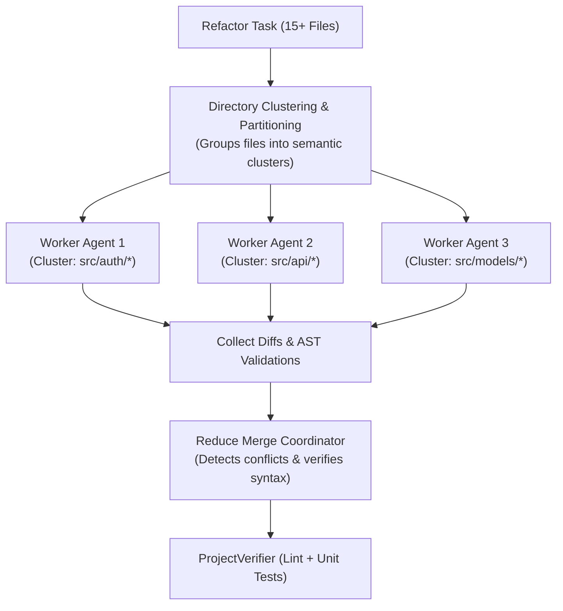

## The Challenge: Cross-Cutting Refactors

When refactoring a central abstraction across 50–100+ files (e.g. updating an authentication middleware or migrating an API protocol), traditional single-thread agents fail due to:
- Context limit exhaustion.
- Lost in the Middle attention degradation.
- Interrupted or inconsistent edits.

---

## The SAGO Map-Reduce Solution

SAGO introduces the **Map-Reduce Parallel Refactoring Coordinator** (`MapReduceRefactorCoordinator` in `sago/orchestrator/delegator.py`):

---

## Key Components

### 1. Partitioning (Map)
Files are grouped into cohesive clusters based on directory depth, module boundaries, and dependency call graphs. Each worker receives only the relevant file skeletons and caller/callee context for its assigned cluster.

### 2. Isolated Execution
Workers execute concurrently with their own context budgets, preventing cross-contamination and context poisoning.

### 3. Verification & Merging (Reduce)
Before applying edits to the workspace:
- Syntax trees are validated with Tree-Sitter AST parsers.
- `ProjectVerifier` runs linters (Ruff, ESLint, `cargo check`) across the joined workspace.
- If conflicts arise, the coordinator resolves them before final commit.
