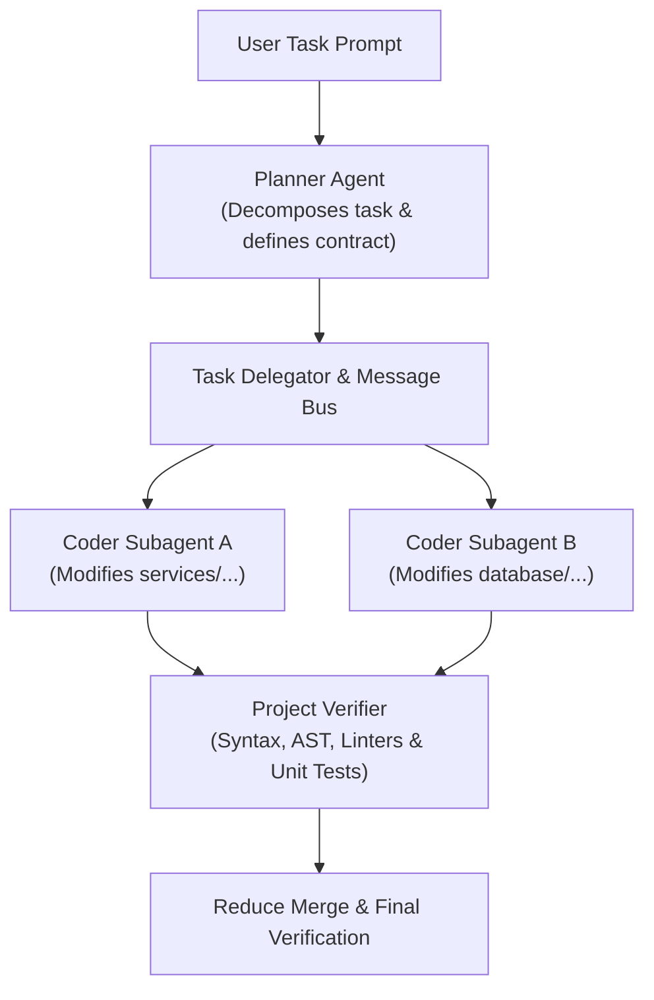

## Orchestration Architecture

SAGO features a decoupled multi-agent engine built upon an asynchronous message bus. Complex engineering tasks are broken down using the **Planner-Coder-Verifier** pattern:



---

## Orchestration Commands

### 1. `/delegate <agent> <task>`
Delegates an isolated subtask to a specialist agent profile in an isolated context window:
```bash
/delegate security-testing-engineer "Audit endpoints in src/auth for JWT vulnerabilities"
```

### 2. `/chain <agent1,agent2> <task>`
Chains multiple agents sequentially, passing the verified outputs of the predecessor to the next:
```bash
/chain api-engineer,frontend-engineer "Implement /api/v1/metrics and build the React summary card"
```

### 3. `/parallel <agent1: task1, agent2: task2>`
Executes multiple specialist agents concurrently:
```bash
/parallel db-engineer: "Add index on orders.created_at", test-engineer: "Write regression tests for orders query"
```

---

## Message Bus IPC & Isolation

- **Isolated Registries:** Subagents operate with scoped tool registries to prevent conflicting write operations.
- **Message Bus:** Agents communicate via structured events (`task_started`, `tool_executed`, `verification_passed`).
- **Instant Cancellation:** Cancellation tokens propagate across the entire subagent tree on <kbd>Ctrl+C</kbd>.
