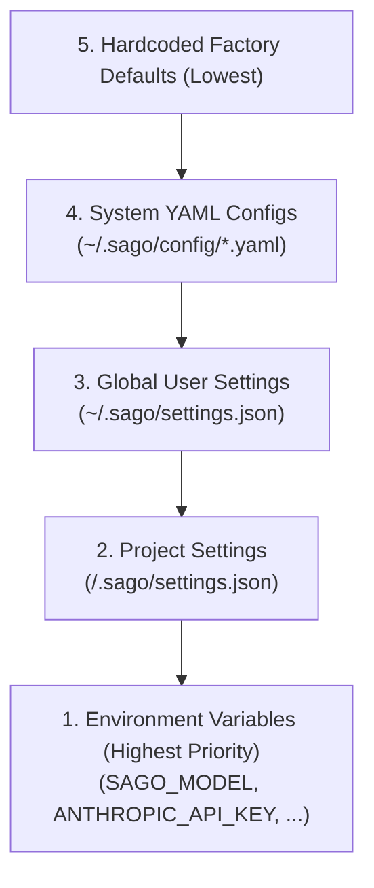

## Configuration Hierarchy

SAGO resolves configuration hierarchically:



---

## `settings.json` Quick Preferences

`~/.sago/settings.json` stores user preferences:

```json
{
  "model": "claude-3-7-sonnet",
  "provider": "anthropic",
  "base_url": null,
  "yolo": false,
  "dev_mode": true,
  "log_level": "info",
  "effort_level": "high",
  "show_summary": true,
  "theme": "tokyo-night"
}
```

### Available Keys

| Key | Type | Default | Description |
|---|---|---|---|
| `model` | `str` | `"openrouter/free"` | Active model identifier (e.g. `claude-3-7-sonnet`, `gemini-2.5-flash`, `gpt-4o`) |
| `provider` | `str` | `"openrouter"` | Active provider (`anthropic`, `google`, `openai`, `deepseek`, `ollama`, `groq`) |
| `base_url` | `str \| null` | `null` | Custom API base URL for Ollama (`http://localhost:11434/v1`) or custom proxies |
| `yolo` | `bool` | `false` | When true, skips confirmation prompts for all tools |
| `dev_mode` | `bool` | `true` | Enables microsecond telemetry and Inspector (<kbd>F2</kbd>) |
| `effort_level` | `str` | `"high"` | Reasoning effort: `"low"`, `"medium"`, `"high"`, `"o1-high"` |
| `show_summary`| `bool` | `true` | Automatically mounts summary card after multi-agent orchestration |

---

## Environment Variables

| Variable | Description |
|---|---|
| `OPENROUTER_API_KEY` | OpenRouter API Key (Supports free models out of the box) |
| `ANTHROPIC_API_KEY` | Anthropic Claude API Key |
| `GEMINI_API_KEY` | Google Gemini API Key |
| `OPENAI_API_KEY` | OpenAI API Key |
| `DEEPSEEK_API_KEY` | DeepSeek API Key |
| `GROQ_API_KEY` | Groq high-speed inference API Key |
| `SAGO_MODEL` | Override active model name |
| `SAGO_PROVIDER` | Override active provider |
| `SAGO_YOLO` | Set to `1` or `true` to enable YOLO mode |
| `SAGO_DEV_MODE` | Set to `1` to enable, `0` to disable Developer Mode |
| `SAGO_COMPACTION_THRESHOLD` | Global context compaction token trigger |
